# 🧠 Chỉ Mục Tri Thức Cốt Lõi (Fact Sheet Index): Bảo Vệ Đề Án Thạc Sĩ 2026

> **Đề tài:** Ứng dụng Business Intelligence để phân tích dữ liệu môi trường cho một huyện (Dự báo nồng độ bụi mịn PM2.5 bằng máy học và học sâu đa mô hình dựa trên dữ liệu cảm biến IoT đa độ phân giải)
> **Học viên:** Hoàng Xuân Trí (trihx) — MSHV: M2522016 | **CBHD:** TS. Nguyễn Minh Khiêm
> **Chuyên ngành:** Hệ thống Thông tin (8480104) — Trường CNTT&TT, ĐH Cần Thơ (QĐ 1799)
> **Tài liệu nguồn gốc (SSOT):** [`docs/defense-2026/01_SECOND_BRAIN_FACTSHEET.md`](file:///Users/trihx/Desktop/time-series-forecasting/docs/defense-2026/01_SECOND_BRAIN_FACTSHEET.md)

---

## 🎯 1. Tóm Tắt Định Vị Đề Án & Sợi Chỉ Đỏ Học Thuật
Đề án giải quyết trọn vẹn bài toán quan trắc và dự báo môi trường cấp huyện trong điều kiện dữ liệu IoT chi phí thấp bị khuyết thiếu nặng nề (**74% qua 38 tháng**, 209.594 bản ghi) bằng một kiến trúc Business Intelligence 3 tầng hoàn chỉnh:
1. **Kỹ nghệ dữ liệu thép:** Dũng cảm loại bỏ 19.810 giờ khuyết dài (>24h) chống tạo ảo giác dữ liệu (`[[02_Tiered_Imputation_and_Data_Sparsity]]`), bảo toàn 66 đỉnh ô nhiễm bằng Domain Bounds [0, 500] µg/m³ (`[[03_Outlier_Trap_and_Domain_Bounds]]`), và kỷ luật `shift(1)` cho 119 đặc trưng triệt tiêu 100% rò rỉ dữ liệu (`[[01_Anti_Leakage_Shift1_Discipline]]`, `[[01_Feature_Store_119_Features]]`).
2. **Khung đa độ phân giải:** Xác lập điểm ngọt Pareto 30 phút (`[[03_Sweet_Spot_30m_Ensemble]]`) và chứng minh mạng GRU 15 phút phá vỡ bẫy tự tương quan của dữ liệu chuỗi 1h (`[[02_Autocorrelation_Trap_and_GRU_15m]]`).
3. **Định lượng bất định & Khả năng giải thích:** Conformal Prediction kết hợp ACI đạt độ phủ thực nghiệm 89,4%–89,6% (`[[03_Uncertainty_Quantification_CQR_ACI]]`) và Tree SHAP phát hiện điểm chuyển pha vi khí hậu 14–17 µg/m³ (`[[02_Threshold_Tipping_Point_14_17]]`).

---

## 🗺️ 2. Mạng Lưới Liên Kết Hai Chiều Tới 22 Chuyên Đề Vault

```mermaid
graph TD
    SSOT["Fact Sheet Cốt Lõi 2026<br/>(docs/defense-2026/01_SECOND_BRAIN_FACTSHEET.md)"]

    subgraph DataEngineering ["1. Kỹ Nghệ & Dữ Liệu"]
        P1["[[01_Pipeline_7_Steps]]"]
        P2["[[02_Tiered_Imputation_and_Data_Sparsity]]"]
        P3["[[03_Outlier_Trap_and_Domain_Bounds]]"]
        P4["[[04_Multi_Resolution_Framing]]"]
    end

    subgraph AntiLeakage ["2. Liêm Chính & Chống Rò Rỉ"]
        L1["[[01_Anti_Leakage_Shift1_Discipline]]"]
        L2["[[02_Temporal_Split_and_Test_on_Real_Only]]"]
    end

    subgraph Features ["3. Kho Đặc Trưng & Tính Dừng"]
        F1["[[01_Feature_Store_119_Features]]"]
        F2["[[02_Stationarity_ADF_KPSS]]"]
    end

    subgraph Models ["4. Mô Hình & Tối Ưu"]
        M1["[[01_Benchmark_Models_Overview]]"]
        M2["[[02_Autocorrelation_Trap_and_GRU_15m]]"]
        M3["[[03_Sweet_Spot_30m_Ensemble]]"]
        M4["[[04_Hyperparameter_Tuning_Optuna]]"]
    end

    subgraph Evaluation ["5. Đánh Giá & Bất Định"]
        E1["[[01_Metrics_Standard_MASE_over_RMSE]]"]
        E2["[[02_Diebold_Mariano_Hypothesis_Testing]]"]
        E3["[[03_Uncertainty_Quantification_CQR_ACI]]"]
    end

    subgraph Explainability ["6. Giải Thích XAI"]
        X1["[[01_Tree_SHAP_vs_Permutation_Importance]]"]
        X2["[[02_Threshold_Tipping_Point_14_17]]"]
        X3["[[03_Diurnal_Cycle_and_Sa_Dec_Context]]"]
    end

    subgraph Defense ["7. Phản Biện Hội Đồng"]
        D1["[[01_Master_Defense_QnA_Hoi_Dong]]"]
        D2["[[02_Slides_Narrative_and_Key_Arguments]]"]
        D3["[[03_Limitations_and_Actionable_Solutions]]"]
    end

    SSOT --> P1 & P2 & P3 & P4
    SSOT --> L1 & L2
    SSOT --> F1 & F2
    SSOT --> M1 & M2 & M3 & M4
    SSOT --> E1 & E2 & E3
    SSOT --> X1 & X2 & X3
    SSOT --> D1 & D2 & D3
```

---

## 📌 3. Tra Cứu Tức Thời Các Bảng & Biểu Đồ Then Chốt Phục Vụ Slides

| Khối nội dung trên Slide | Bảng / Hình ảnh minh chứng | Tọa độ Báo cáo Luận văn | Ghi chú khoa học then chốt |
| :--- | :--- | :--- | :--- |
| **Quy trình nghiên cứu** | [Hình 1.1](file:///Users/trihx/Desktop/time-series-forecasting/docs/pics/Hinh_1.1_Overview_Pipeline.png) | `THESIS_DRAFT_CTU_1799.md:305` | 7 bước tiền xử lý, tái lấy mẫu 15m/30m/1h |
| **Kiến trúc phần mềm** | [Hình 3.1](file:///Users/trihx/Desktop/time-series-forecasting/docs/pics/Hinh_3.1_System_Architecture.png) | `THESIS_DRAFT_CTU_1799.md:835` | 3 tầng Streamlit - FastAPI - PostgreSQL Docker |
| **Độ phủ dữ liệu IoT** | [Hình 4.5a](file:///Users/trihx/Desktop/time-series-forecasting/docs/pics/Hinh_4.5a_Missing_Data_Barcode.png) & Bảng 3.2 | `THESIS_DRAFT_CTU_1799.md:585, 976` | Khuyết 74% qua 38 tháng, T2 khuyết 64%, T9 khuyết 73% |
| **Tiered Imputation** | [Hình 4.5b](file:///Users/trihx/Desktop/time-series-forecasting/docs/pics/Hinh_4.5b_Interpolation_Recovery_Limit.png) & Bảng 3.4 | `THESIS_DRAFT_CTU_1799.md:740, 982` | Dũng cảm Drop 19.810 giờ (>24h) chống tạo dữ liệu giả |
| **Bảo toàn ngoại lai** | [Hình 4.12](file:///Users/trihx/Desktop/time-series-forecasting/docs/pics/Hinh_4.12_Ablation_Outlier_Impact.png) & Hình 4.3a | `THESIS_DRAFT_CTU_1799.md:936, 1306` | Domain Bounds [0, 500] giữ 66 đỉnh; S-ESD giảm 14–18% RMSE |
| **Chống rò rỉ dữ liệu** | Bảng 4.2 | `THESIS_DRAFT_CTU_1799.md:994` | `shift(1)` đưa $R^2=1,000$ ảo về $0,267$ thực chất |
| **Kiểm định tính dừng** | Bảng 4.1 & Hình 4.1a–4.1c | `THESIS_DRAFT_CTU_1799.md:874` | Chuỗi gốc Trend-stationary; Sai phân $d=1$ & $D=1$ đạt I(0) |
| **Bẫy tự tương quan 1h** | [Hình 4.2a](file:///Users/trihx/Desktop/time-series-forecasting/docs/pics/Hinh_4.2a_Autocorrelation_Memory.png) & Bảng 4.3 | `THESIS_DRAFT_CTU_1799.md:919, 1010` | $r \approx 0,86$; GRU 15m phá bẫy đạt $\text{MASE} = 0,667$ |
| **Điểm ngọt 30m & Quán quân** | Bảng 4.3 | `THESIS_DRAFT_CTU_1799.md:1010` | Ensemble v9 30m đạt $\text{MASE}=0,382$ ở 6h; trên test giảm 49,6% MAE so với Persistence |
| **Ý nghĩa thống kê DM** | Bảng 4.7 | `THESIS_DRAFT_CTU_1799.md:1273` | DM = -8,452 ở 6h ($p<0,001$); giải trình dấu dương ở 1h |
| **XAI Tipping Point** | [Hình 4.8](file:///Users/trihx/Desktop/time-series-forecasting/docs/pics/Hinh_4.8_SHAP_Dependence_6h.png) & Bảng 4.5 | `THESIS_DRAFT_CTU_1799.md:1146, 1203` | Điểm chuyển pha 14–17 $\mu\text{g/m}^3$, bùng phát khi >17 |
| **Khoảng tin cậy ACI** | [Hình 4.11a–c](file:///Users/trihx/Desktop/time-series-forecasting/docs/pics/Hinh_4.11b_PI_Conformal_LightGBM_6h.png) & Bảng 4.6 | `THESIS_DRAFT_CTU_1799.md:1229` | ACI khôi phục độ phủ 89,5%–89,6%, tối ưu Winkler Score |
| **Cảnh báo vượt ngưỡng WHO**| Bảng 4.8 | `THESIS_DRAFT_CTU_1799.md:1285` | F1 = 0,782 tại 6h với 57 đợt ô nhiễm thực tế |
| **Ma trận điều hành & Hạn chế**| Bảng 5.3 & Bảng 5.3b | `src/conclusion_page.py:322, 393` | 3 cấp điều hành, 5 hạn chế & 5 giải pháp đột phá |

---
*Ghi chú liên kết: Xem tiếp [[02_Discrepancy_Register]] để đối soát toàn bộ các điểm sai lệch số liệu giữa các tài liệu trước ngày bảo vệ.*
